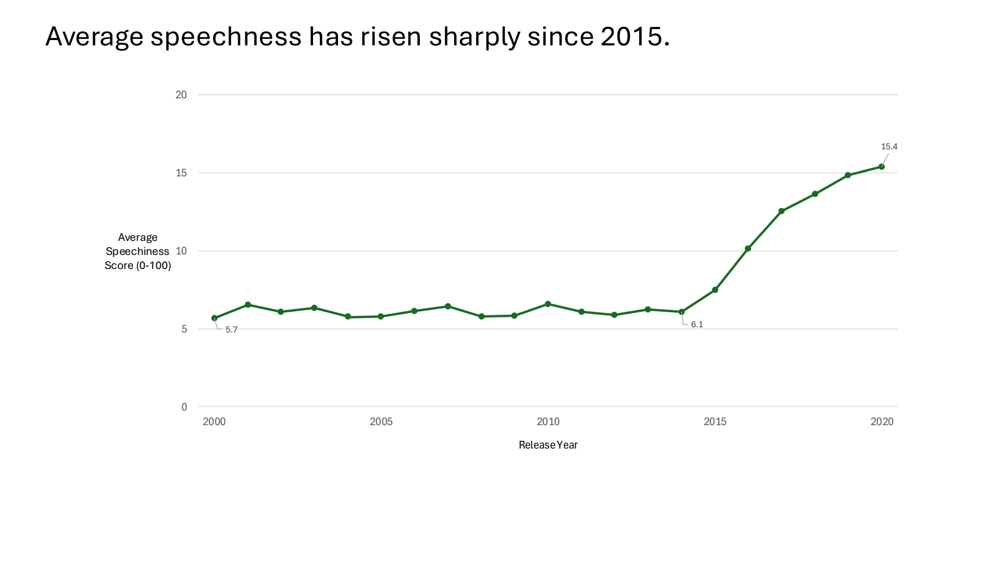
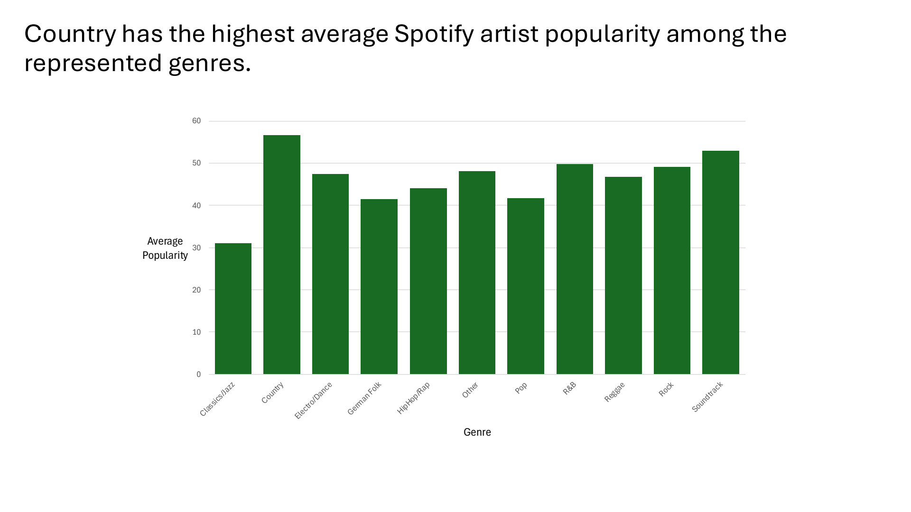
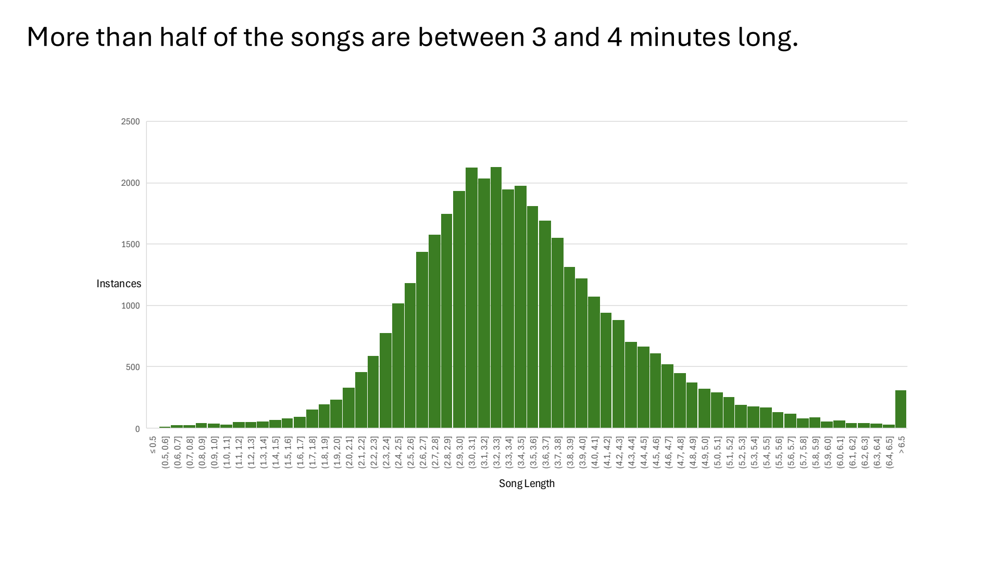
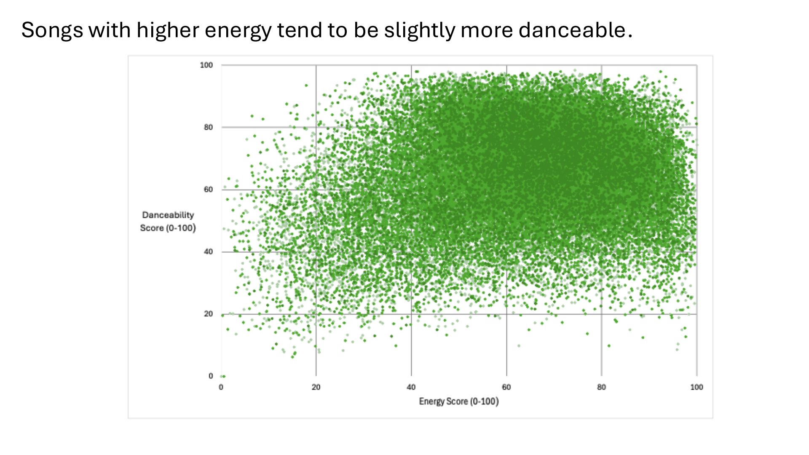

## Team Members

This project was completed by the following team members:

- [William Hendrix](https://swisscheeseisholy.github.io/)
- [Carter O’Dell](https://carter-s-o.github.io/)
- [Mattie McGarrah](https://mattiemcgarrah.github.io/Mattie-McGarrah.github.io/)
- [Elizabeth Brock](https://elizabeth-diane.github.io/)
- [Sarah Draper](https://SarahDraper.github.io/)

## Description

For this project, our team analyzed a music streaming dataset from the WU-RDS MA2022 repository containing 66,796 songs and variables related to chart performance, artist popularity, and song characteristics. The dataset includes songs that appeared in Top 200 charts and contains information such as genre, release date, song length, speechiness, danceability, energy, and Spotify artist popularity.

We cleaned and organized the data in Microsoft Excel, selected the variables relevant to our four research questions, and created a line chart, bar chart, histogram, and scatter plot to explore trends in music and streaming behavior.

{fig-alt="Assertion-evidence slide: average speechiness has risen sharply since 2015. A line chart shows average speechiness by release year from 2000 to 2020." width=100%}

**How has the average speechiness score of songs changed by release year from 2000 to 2020?** We were interested in this question because speechiness can help show how the style of popular music has changed over time, especially with the increased popularity of genres that include more spoken or rap-style vocals. To answer the question, we used the Release Year and Speechiness Score columns from our cleaned dataset. In Excel, we created a PivotTable that grouped the songs by release year and calculated the average speechiness score for each year. We focused on songs released from 2000 through 2020 because earlier years contained much smaller numbers of songs in the dataset, which could make their yearly averages less representative. We then created a line chart with release year on the x-axis and average speechiness score on the y-axis. We formatted the chart by simplifying the gridlines, adding clear axis titles, and using consistent colors so that the changes over time were easier to see.

{fig-alt="Assertion-evidence slide: country has the highest average Spotify artist popularity among the represented genres. A bar chart compares average popularity across eleven genres." width=100%}

**Which music genres have the highest average Spotify popularity?** We were interested in this question because different genres have different audiences, and we wanted to see whether certain types of music were associated with more popular artists on Spotify. To create the bar chart, we used the Genre and Spotify Popularity columns from our cleaned dataset. We created a PivotTable in Excel that grouped the songs by genre and calculated the average Spotify popularity score for each genre. The popularity variable is a 0–100 Spotify artist popularity index, where higher values represent greater popularity. We sorted the genre averages so they could be compared more easily and then created a bar chart using the summarized values. We formatted the chart by adjusting the colors, adding clear axis titles, and making the genre labels easier to read. The visual makes it easy to compare average artist popularity across the different genres represented in the dataset.

{fig-alt="Assertion-evidence slide: more than half of the songs are between three and four minutes long. A histogram shows the distribution of song length." width=100%}

**What is the distribution of song lengths?** We were interested in this question because song duration can vary depending on the type and style of music, and we wanted to see what song lengths were most common in the dataset. To create the histogram, we used the Song Length column from our cleaned dataset, which measures the duration of each song in minutes. In Excel, we created a histogram that grouped the song lengths into intervals, or bins, and counted how many songs fell into each interval. We adjusted the bins and axis formatting so the overall shape of the distribution would be easier to interpret. We also added clear axis titles and simplified the visual so the most common range of song lengths could be easily identified. The resulting graph shows that the majority of songs are concentrated within the typical range of a few minutes rather than being extremely short or extremely long.

{fig-alt="Assertion-evidence slide: songs with higher energy tend to be slightly more danceable. A scatter plot compares energy and danceability scores from zero to one hundred." width=100%}

**Is there a relationship between a song’s danceability and energy?** We were interested in this question because danceability and energy both describe characteristics of how a song sounds, but they measure different features. Danceability describes how suitable a song is for dancing based on characteristics such as rhythm, tempo, and beat consistency, while energy represents the perceived intensity and activity of a song. Higher scores indicate greater danceability or energy. To create the scatter plot, we used the Danceability Score and Energy Score columns from our cleaned dataset. We plotted energy on the x-axis and danceability on the y-axis so that each point represented an individual song. We then reformatted the axes, labels, colors, and scale to make the large number of observations easier to read. Looking at the overall pattern of the points, songs with higher energy scores tend to have slightly higher danceability scores. However, the points are widely spread across the graph, suggesting that the relationship between energy and danceability is relatively weak.

[Download the assertion-evidence slides (PDF)](music-slides.pdf)
